<div align="center">

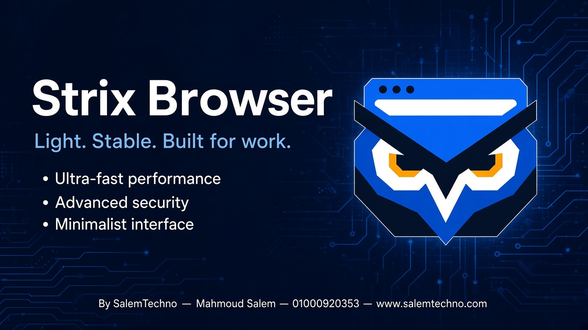

<br /><br />


# 🌐 Strix Browser v1.0.0
### **High-Performance Self-Contained Chromium Windows Browser for Surveillance (DVR/NVR), Call Centers, Network Engineers & Daily Enterprise Work**
### **المتصفح الاحترافي الفائق السرعة لأنظمة المراقبة والكاميرات، غرف الكول سنتر، مهندسي الشبكات، والتصفح المؤسسي اليومي**

**تصميم وبرمجة: مهندس محمود سالم (Eng. Mahmoud Salem) — [شركة سالم تيكنو | Salem Techno IT Solutions](https://www.salemtechno.com)**  
📞 **الهاتف / واتساب (Phone / WhatsApp):** [`01000920353`](https://wa.me/201000920353) (`+201000920353`) &nbsp;|&nbsp; 🌐 **الموقع الرسمي (Official Website):** [www.salemtechno.com](https://www.salemtechno.com)

<br />

<!-- Row 1: Core Architecture & Engineering Badges -->
<p align="center">
  
  
  
  
  
</p>

<!-- Row 2: Direct 1-Click Release Download Action Badges -->
<p align="center">
  <a href="https://github.com/SalemTechno/Strix-Browser/releases/download/v1.0.0/StrixBrowser-Setup-1.0.0-x64.exe">
    
  </a>
  <a href="https://github.com/SalemTechno/Strix-Browser/releases/download/v1.0.0/StrixBrowser-1.0.0.msi">
    
  </a>
  <a href="https://github.com/SalemTechno/Strix-Browser/releases/download/v1.0.0/StrixBrowser-Portable-1.0.0-x64.zip">
    
  </a>
  <a href="https://github.com/SalemTechno/Strix-Browser/raw/main/v1.0.0/4_Documentation_and_Guide/Strix_Browser_v1.0.0_Interactive_Guide_HTML5.html">
    
  </a>
</p>

<!-- Row 3: Contact Action Badges -->
<p align="center">
  <a href="https://www.salemtechno.com">
    
  </a>
  <a href="https://wa.me/201000920353">
    
  </a>
</p>

<!-- Row 4: Quick Section Navigation Pills -->
<p align="center">
  <a href="#downloads"></a>
  <a href="#features"></a>
  <a href="#screenshots"></a>
  <a href="#specs"></a>
  <a href="#security"></a>
  <a href="#contact"></a>
</p>

</div>

---

## 📖 نبذة تعريفية شاملة | Executive Overview (Arabic & English)

> [!IMPORTANT]
> **🇪🇬 نبذة عن المتصفح (العربية):**  
> **Strix Browser v1.0.0** هو متصفح ويب مكتبي احترافي فائق السرعة ومستقل بالكامل (`100% Self-Contained x64`) لأنظمة **Windows 10 / 11 / Server**، مبني على نواة **Chromium 131** مع واجهة أصلية **`.NET 8 WPF (ReadyToRun AOT)`** بدون أي متطلبات تثبيت خارجية. صُمم خصيصاً ليجمع بين **السرعة الخاطفة والاستهلاك المنخفض للذاكرة** وبين أدوات هندسية حقيقية غير موجودة في المتصفحات التقليدية:
> - **مفتاح `Keep Alive Mode` المستقل لكل تابة:** يمنع تجميد أو فصل جلسات **WhatsApp Web، أنظمة الكول سنتر WebRTC، لوحات المراقبة، والداشبورد الحية** مع إبقاء الصوت والإشعارات و`WebSockets` نشطة 24/7.
> - **موفر الذاكرة الحقيقي (`Real Memory Saver`) + تعليق التابات الخلفية (`WasHidden`):** يوقف تصيير التابات غير النشطة ويفرّغ عمليات Chromium للتابات الخاملة تلقائياً لتقليل استهلاك الرام والـ CPU، مع عرض إجمالي الرام الفعلي للمتصفح لحظياً.
> - **تهيئة تلقائية صامتة لأنظمة المراقبة (`DVR / NVR / IP Cameras`):** يتعرف تلقائياً على أجهزة **Dahua / Hikvision / Uniview / Tiandy** ويفضل مسار **HTML5 / HEVC (H.265) / WebRTC / MSE** ويمنع تحميل الإضافات التالفة (`.cab / .ocx`) مع قبول الشهادات الذاتية للشبكة المحلية فقط (`LAN Only`).
> - **طبيب الشبكة المدمج (`Network Doctor — Ctrl+Shift+D`):** يحلل مراحل الاتصال بدقة (**`DNS → TCP → TLS → HTTP`**) مع فحص فوري لأي رابط ونسخ تقرير جاهز لفريق الشبكات والفايروول.
> - **مدير تحميلات توربو بأسلوب IDM (`Multi-Stream Turbo Downloads`):** حتى **16 قناة اتصال متوازية** مع دعم الإيقاف والاستئناف الحقيقي للأجزاء (`.strixpart.json`) والفرز حسب التصنيف.
> - **نظام بروفايلات معزولة + ربط حساب Gmail + خزنة باسوردات مشفرة (`DPAPI + AES-256-GCM`):** استيراد مباشر من **Chrome / Edge / Brave / Vivaldi / Opera / Windows Credential Manager**، وسحب تلقائي لبـاسوردات سحابة جوجل (`passwords.google.com`) داخل المتصفح مع مسح الملف المؤقت تلقائياً، إضافة إلى مراقبة استهلاك الكوتا (`MB / GB`) ومدة التشغيل لكل موقع!

> [!NOTE]
> **🇬🇧 Executive Overview (English):**  
> **Strix Browser v1.0.0** is an enterprise-grade, **100% Self-Contained 64-bit Windows** desktop web browser engineered on **Chromium 131 (CefSharp)** and native **`.NET 8 WPF` with ReadyToRun (AOT)** native compilation — requiring **zero external runtimes** (`.NET 8.0.31` and `VC++ 140` are bundled inside). Designed for **Surveillance (CCTV/NVR/DVR) operators**, **Call-Center / WebRTC desks**, **Network & IT Engineers**, and **everyday high-speed browsing**, it delivers:
> - **Native Chromium C++ Fast-Path & `WasHidden` Tab Compositor Suspension** for silky-smooth, zero-freeze browsing.
> - **Per-Tab `Keep Alive Mode` + Real `Memory Saver`** (genuinely unloads idle background renderers while keeping pinned/Keep-Alive/WebRTC tabs alive 24/7).
> - **Silent Auto-Prepare for `Dahua / Hikvision / Uniview / Tiandy` Recorders** (HTML5/H.265/WebRTC + private-LAN-only self-signed TLS trust + quiet Edge IE Mode legacy fallback).
> - **Built-in `Network Doctor` (`DNS → TCP → TLS → HTTP`)** diagnostics (`Ctrl+Shift+D`).
> - **IDM-Style Multi-Connection Turbo Download Manager** (up to 16 parallel HTTP Range streams with segmented Pause/Resume).
> - **Multi-Profile Isolation, Gmail Account Binding, `DPAPI` + `AES-256-GCM` Encrypted Vault (`STRX2`), Multi-Browser Import & Automatic Google Cloud Password Sync (`passwords.google.com`)**.
> - **Strict Public HTTPS Validation, Built-in Ad & Tracker Blocker (95+ ad/tracking networks), Real-Time Per-Site Data Quota (`MB/GB`) & Duration Telemetry, and Strict Per-Tab RAM-Only Incognito Mode**.

---

<a id="downloads"></a>
## 📦 التحميل المباشر وهيكل مجلد الإصدار (`v1.0.0/`) | Direct Downloads & Versioned Structure

**🇪🇬 العربية:** تم تنظيم المستودع بنظام **المجلدات المرقّمة حسب رقم الإصدار (`v1.0.0/`)** بحيث يحصل كل إصدار مستقبلي على مجلد مستقل خاص به (`v1.0.0/`، `v1.1.0/`، إلخ)، مع استضافة النسخ الثنائية الكاملة (بدون سورس كود) على **GitHub Releases** بروابط تحميل مباشرة بضغطة واحدة وبصمات تحقق أمنية **`SHA-256`**:  
**🇬🇧 English:** This repository is organized cleanly by **versioned release folders (`v1.0.0/`)** so each release ships in its own dedicated directory, with all **100% Self-Contained binary packages** (strictly binary-only — **zero source code**) hosted directly on **GitHub Releases** with `SHA-256` verification:

| المجلد / الحزمة (Versioned Folder / Package) | الوصف الكامل بالعربية والإنجليزية (Bilingual Description) | الحجم (Size) | التحميل المباشر (1-Click Download) |
| :--- | :--- | :---: | :---: |
| 📂 [**`v1.0.0/2_Setup_Installer_EXE`**](./v1.0.0/2_Setup_Installer_EXE/) | **🇪🇬 معالج التثبيت الرسمي (`Setup Wizard EXE`):** يثبت المتصفح المستقل في `Program Files` مع اختصار سطح المكتب وقائمة ابدأ ويدعم التحديث النظيف والتثبيت الصامت.<br/>**🇬🇧 Official Inno Setup GUI Wizard:** Installs Self-Contained x64 build into `Program Files`, creates Desktop/Start Menu shortcuts, supports clean upgrade & silent CLI install. | `135.20 MB` | [](https://github.com/SalemTechno/Strix-Browser/releases/download/v1.0.0/StrixBrowser-Setup-1.0.0-x64.exe) |
| 📂 [**`v1.0.0/3_MSI_Enterprise_Package`**](./v1.0.0/3_MSI_Enterprise_Package/) | **🇪🇬 حزمة تثبيت المؤسسات (`Windows Installer MSI`):** مخصصة للنشر الصامت المركزي عبر Active Directory GPO و SCCM و Intune.<br/>**🇬🇧 Native 64-bit Windows MSI Package:** Built for enterprise centralized deployment via Active Directory GPO, SCCM, and Microsoft Intune. | `135.71 MB` | [](https://github.com/SalemTechno/Strix-Browser/releases/download/v1.0.0/StrixBrowser-1.0.0.msi) |
| 📂 [**`v1.0.0/1_Portable_Edition`**](./v1.0.0/1_Portable_Edition/) | **🇪🇬 النسخة المحمولة المستقلة (`Portable ZIP`):** فك الضغط وشغّل `StrixBrowser.exe` فوراً بدون تثبيت وبدون الحاجة لـ `.NET 8` أو `VC++`.<br/>**🇬🇧 Standalone Self-Contained Portable ZIP:** Extract `Strix Browser\` and run `StrixBrowser.exe` immediately with zero external dependencies. | `181.99 MB` | [](https://github.com/SalemTechno/Strix-Browser/releases/download/v1.0.0/StrixBrowser-Portable-1.0.0-x64.zip) |
| 📂 [**`v1.0.0/4_Documentation_and_Guide`**](./v1.0.0/4_Documentation_and_Guide/) | **🇪🇬 الدليل التفاعلي والتقرير الهندسي (`HTML5 + Markdown`):** دليل مصور يعمل بدون إنترنت + التقرير الفني الشامل.<br/>**🇬🇧 Offline Interactive HTML5 Guide & Technical Report:** Complete visual product guide and engineering documentation. | `3 Docs` | [](./v1.0.0/4_Documentation_and_Guide/) |
| 📂 [**`v1.0.0/5_Screenshots_and_Assets`**](./v1.0.0/5_Screenshots_and_Assets/) | **🇪🇬 معرض الشاشات والشعارات الرسمية (`13 HD Screens + Brand Kit`):** لقطات شاشة حية بدقة عالية لجميع واجهات وإعدادات الإصدار `v1.0.0`.<br/>**🇬🇧 Official HD Screenshots & Brand Assets:** All 13 full-resolution captures of Strix Browser v1.0.0 screens and official branding. | `16 Assets` | [](./v1.0.0/5_Screenshots_and_Assets/) |
| 🔐 [**`v1.0.0/SHA256SUMS.txt`**](./v1.0.0/SHA256SUMS.txt) | **🇪🇬 بصمات التحقق الأمنية (`SHA-256 Checksums`):** للتحقق من سلامة وأصالة كافة ملفات التوزيع.<br/>**🇬🇧 Cryptographic SHA-256 Checksums:** Verify exact binary integrity of all three packages. | `SHA-256` | [](https://github.com/SalemTechno/Strix-Browser/releases/download/v1.0.0/SHA256SUMS.txt) |

> [!TIP]
> **💻 أوامر التثبيت الصامت لمديري الأنظمة | Silent CLI & GPO Deployment for IT Administrators:**
> - **Silent EXE Install (تثبيت صامت لملف Setup):** `StrixBrowser-Setup-1.0.0-x64.exe /VERYSILENT /SUPPRESSMSGBOXES /NORESTART`
> - **Silent MSI GPO Install (تثبيت صامت لحزمة MSI):** `msiexec /i StrixBrowser-1.0.0.msi /qn /norestart`

---

<a id="features"></a>
## ✨ المميزات والقدرات الهندسية الشاملة | Complete Engineering Features (v1.0.0)

1. **⚡ سرعة أصلية فائقة وإقلاع فوري (`Chromium 131 Native Fast-Path + ReadyToRun AOT`)**
   - **🇪🇬 عربي:** تمرير الموارد الفرعية للصفحات بنسبة 100% داخل نواة C++ الأصلية مع تفعيل كاش شيدر الـ GPU (`GPU Rasterization & Zero-Copy`)، وتعليق تصيير التابات الخلفية تلقائياً عبر `WasHidden(true)` مثل Google Chrome تماماً لمنع أي ثقل أو تهنيج.
   - **🇬🇧 English:** Zero-marshaling native C++ subresource pipeline, hardware GPU rasterization & shader caching, ReadyToRun (AOT) native code startup, and automatic CEF `WasHidden` compositor throttling on hidden tabs.

2. **🟢 وضع البقاء النشط لكل تابة (`Per-Tab Keep Alive Mode`)**
   - **🇪🇬 عربي:** مفتاح واحد في الشريط العلوي (`Keep Alive Mode`) يُطبّق على التابة النشطة فقط ليحميها من التفريغ ويبقي **WhatsApp Web، المكالمات الصوتية WebRTC، الإشعارات، الصوت، وبث الكاميرات 24/7** متصلاً باستمرار بدون انقطاع.
   - **🇬🇧 English:** Single per-tab toolbar switch that exempts critical dashboards, WhatsApp/chat tabs, softphones, and live CCTV feeds from Memory Saver discarding while keeping audio, notifications, WebRTC, and WebSockets continuously active.

3. **🧠 موفر الذاكرة الحقيقي ومؤشر الرام الفعلي (`Real Memory Saver & Total Multi-Process RAM Monitor`)**
   - **🇪🇬 عربي:** يقوم فعلياً بإغلاق وتفريغ عمليات Chromium للتابات الخاملة في الخلفية لاستعادة مئات الميجابايت من الرام، ثم يعيد تحميل التابة بسلاسة فور النقر عليها، مع عرض إجمالي استهلاك الرام الفعلي (الواجهة + جميع عمليات Chromium الفرعية).
   - **🇬🇧 English:** Genuinely disposes Chromium renderer hosts for idle non-exempt background tabs to reclaim RAM and reloads them on click, paired with an accurate live multi-process RAM indicator in the status bar.

4. **📹 التهيئة التلقائية الصامتة لأنظمة المراقبة (`Silent Auto DVR / NVR / IP Camera Assist`)**
   - **🇪🇬 عربي:** يتعرف تلقائياً على أجهزة **Dahua، Hikvision، Uniview، Tiandy** ومسجلات الشبكة المحلية، فيفعّل `Keep Alive` ويفضّل مسار **HTML5 / HEVC (H.265) / WebRTC / MSE** ويمنع تحميل ملفات الإضافات القديمة (`.cab / .ocx`)، مع إتاحة خيار هادئ `Open in Edge IE mode` من قائمة `⋮ → More tools` للأجهزة القديمة جداً.
   - **🇬🇧 English:** Silently detects Dahua, Hikvision, Uniview, Tiandy, and LAN recorders, steers firmware toward HTML5/HEVC/WebRTC playback, blocks legacy `.cab`/`.ocx` download loops, and provides a quiet optional Edge IE mode fallback.

5. **🩺 طبيب الشبكة والتشخيص المرحلي (`Built-in Network Doctor — Ctrl+Shift+D`)**
   - **🇪🇬 عربي:** أداة تشخيص فورية لمهندسي الشبكات تعرض بدقة في أي مرحلة توقف الموقع (**`DNS ✓ → TCP ✓ → TLS ✗ → HTTP –`**) مع الدومين والـ IP والبورت والمسار ورمز الخطأ، وأداة فحص نشطة (`Probe URL`) ونسخ التقرير الجاهز لفريق الفايروول بضغطة زر.
   - **🇬🇧 English:** Instant firewall/network troubleshooting panel (`⋮ → Network Doctor` or `Ctrl+Shift+D`) pinpointing exact failure stages (`DNS → TCP → TLS → HTTP`), active host probing, auth-endpoint filtering, and 1-click diagnostic report export.

6. **⬇️ مدير تحميلات توربو متعدد القنوات (`IDM-Style Multi-Stream Turbo Download Manager`)**
   - **🇪🇬 عربي:** يدعم التحميل المباشر حتى **16 قناة HTTP Range متوازية** مع إيقاف مؤقت واستئناف حقيقي للأجزاء المحمّلة (`.strixpart.json`)، حساب السرعة والوقت المتبقي (`ETA`)، الفرز حسب نوع الملف، والتقاط روابط الحافظة.
   - **🇬🇧 English:** Hybrid Chrome + IDM download manager supporting up to 16 parallel HTTP Range streams, resilient segmented Pause/Resume manifests, real-time speed/ETA telemetry, category tabs, and clipboard URL grabber.

7. **👤 بروفايلات معزولة + ربط Gmail + سحب باسوردات Google Cloud (`Multi-Profile & Smart Vault`)**
   - **🇪🇬 عربي:** كل يوزر/بروفايل له مجلد معزول بالكامل (`Cookies, LocalStorage, Passwords, History, Bookmarks`)، مع وضع العام (`Default`) الذي يعرض سجل وتقارير كوتا جميع المواقع، وإمكانية ربط حساب **Gmail**، استيراد من **Chrome / Edge / Brave / Vivaldi / Opera / Windows Vault**، وسحب تلقائي لبـاسوردات **`passwords.google.com`** داخل المتصفح مع مسح ملف الـ CSV المؤقت تلقائياً وتصدير/استيراد خزنة مشفرة **`.strixvault (AES-256-GCM)`**.
   - **🇬🇧 English:** Chrome-style isolated local profiles with 1-click Gmail binding, multi-browser importer (Chrome, Edge, Brave, Vivaldi, Opera & Windows Credential Manager), automatic in-browser `passwords.google.com` cloud export capture (auto-encrypts into `DPAPI` vault and deletes the temp CSV), React/Vue/Angular-compatible autofill, and cross-PC `AES-256-GCM` `.strixvault` encrypted backup/restore.

8. **📊 قياس استهلاك الكوتا ومدة التصفح لكل موقع (`Per-Site Bandwidth Quota & Active Duration`)**
   - **🇪🇬 عربي:** سجل تصفح ذكي يحسب لكل موقع ودومين **استهلاك البيانات الفعلي (`KB / MB / GB`)، مدة التشغيل، عدد الزيارات، وآخر وقت زيارة** مع فلاتر زمنية (`Today / Week / Month / 3 Months / All`) وبحث فوري.
   - **🇬🇧 English:** Detailed browsing history & per-domain quota analytics tracking real data consumption (`MB/GB`), active/Keep-Alive duration, visit count, and timestamps with period filters and instant debounced search.

9. **🛡️ أمان صارم للإنترنت + مانع إعلانات مدمج + تصفح متخفي معزول بالكامل**
   - **🇪🇬 عربي:** تحقق صارم من شهادات HTTPS على الإنترنت العام (مع السماح بالشهادات الذاتية للشبكة المحلية فقط)، دعم `HTTPS-Only Mode`، مانع إعلانات وتتبع مدمج يحجب أكثر من **95 شبكة إعلانية وتعقب** دون كسر المواقع، ودعم كامل لنوافذ تسجيل الدخول والدفع (`OAuth / 3DS Popups`)، وتصفح متخفي (`Ctrl+Shift+N`) معزول بالذاكرة (`RAM-Only`) لا يسرب أي بيانات للهيستوري أو الكاش أو الأيقونات.
   - **🇬🇧 English:** Strict public HTTPS certificate enforcement (LAN-only self-signed trust), real `HTTPS-Only Mode`, lightweight O(1) Ad & Tracker Blocker (95+ ad/tracking networks), full `window.opener` OAuth/3DS popup compatibility, and strictly isolated per-tab RAM-only Incognito mode.

---

<a id="screenshots"></a>
## 🖼️ الشرح المصور الشامل لجميع شاشات المتصفح (13 شاشة عالية الدقة)
## Screen-by-Screen Visual Guide — Strix Browser v1.0.0 (All 13 HD Screens)

---

### 🔹 شاشة (01): الواجهة الرئيسية، التابات الذكية، ومفتاح Keep Alive Mode | Main Browser Chrome, Tabs & Keep Alive Mode

<div align="center">
  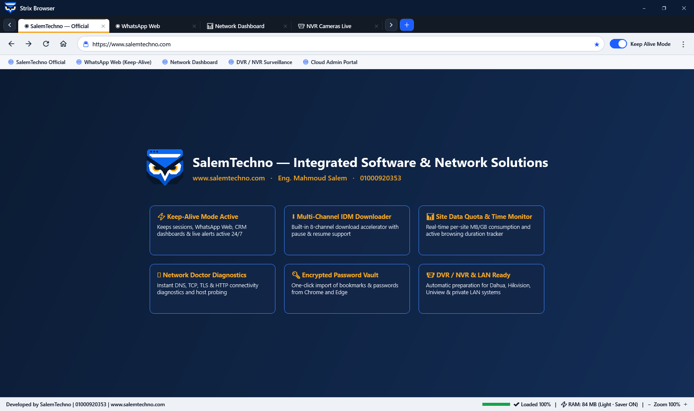
</div>

- **🇪🇬 عربي:** شريط تابات عصري يدعم أيقونات المواقع الحقيقية (`favicon.ico`) وأسهم التنقل والتمرير بالماوس ومؤشرات التثبيت (`📌`) والكتم (`🔇`) والبقاء النشط (`◉`)، شريط عناوين ذكي (`Omnibox`) يدعم `localhost:port` و`IPv4/IPv6`، شريط المفضلة، مفتاح **`Keep Alive Mode`** الموحد، وشريط سفلي يعرض نسبة التحميل ومؤشر الرام الإجمالي الفعلي والتحكم في التكبير (`Zoom`).
- **🇬🇧 English:** Sleek modern tab strip with real `.ico`/`.png` favicons, pin/mute/Keep-Alive indicators, smart omnibox (`localhost:port`, IPv4/IPv6, domains, search), Bookmarks Bar, per-tab **`Keep Alive Mode`** switch, and real-time progress, total RAM, and Zoom footer bar.

---

### 🔹 شاشة (02): القائمة الرئيسية (⋮) والتنقل السريع | Main 3-Dot Menu (⋮) & Quick Tools

<div align="center">
  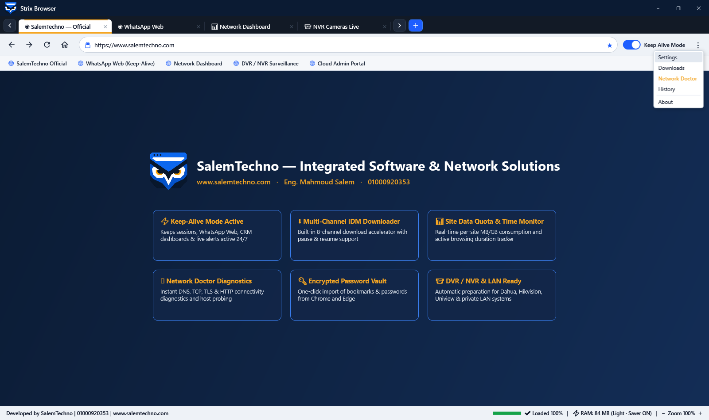
</div>

- **🇪🇬 عربي:** قائمة مرتبة ونظيفة تضم: فتح تابة التصفح المتخفي المعزولة (`Ctrl+Shift+N`)، التبديل السريع بين البروفايلات، الإعدادات، مدير التحميلات (`IDM`)، **طبيب الشبكة (`Network Doctor`)** بلون مميز، الهيستوري والكوتا، وأدوات المراقبة (`Surveillance tools` + `Open in Edge IE mode`).
- **🇬🇧 English:** Streamlined 3-dot (`⋮`) menu providing instant access to Incognito Tabs (`Ctrl+Shift+N`), Profile switcher, Settings, Downloads, accented **Network Doctor**, History, More Tools (`Surveillance tools` & `Open in Edge IE mode`), and About.

---

### 🔹 شاشة (03): مدير التحميلات التوربو متعدد القنوات (IDM-Style) | Multi-Stream Turbo Download Manager

<div align="center">
  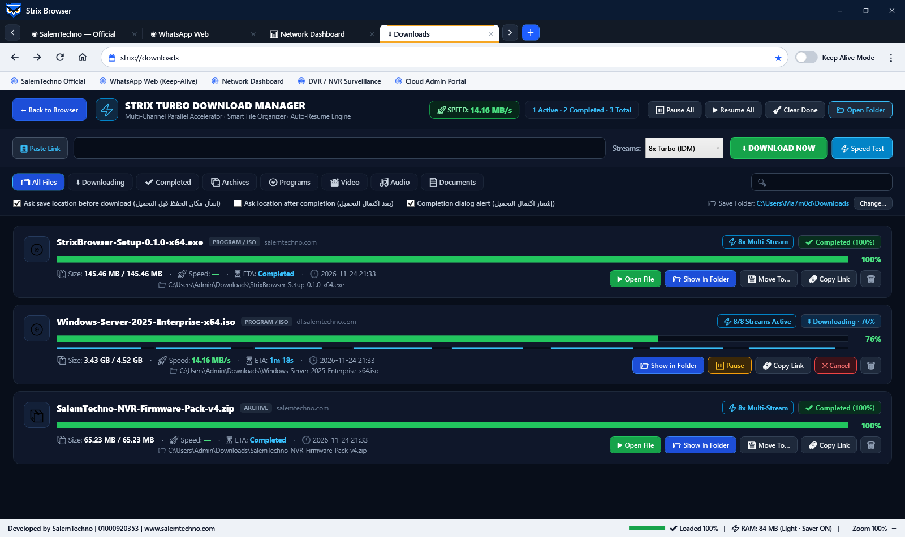
</div>

- **🇪🇬 عربي:** واجهة تحميل احترافية داكنة تدعم لصق الروابط المباشرة، اختيار عدد القنوات (`1x` إلى `16x`)، أشرطة تقدم حقيقية لكل قناة، الإيقاف والاستئناف الحقيقي للأجزاء، الفرز حسب النوع (`Programs / Video / Audio / Compressed / Documents`)، وإشعار اكتمال التحميل.
- **🇬🇧 English:** Dark executive IDM-style Download Manager featuring direct URL grabbing, selectable `1x–16x` parallel streams, real per-channel progress indicators, resilient segmented Pause/Resume, file category tabs, and completion alerts.

---

### 🔹 شاشة (04): طبيب الشبكة وتشخيص الفايروول | Built-in Network Doctor (`DNS → TCP → TLS → HTTP`)

<div align="center">
  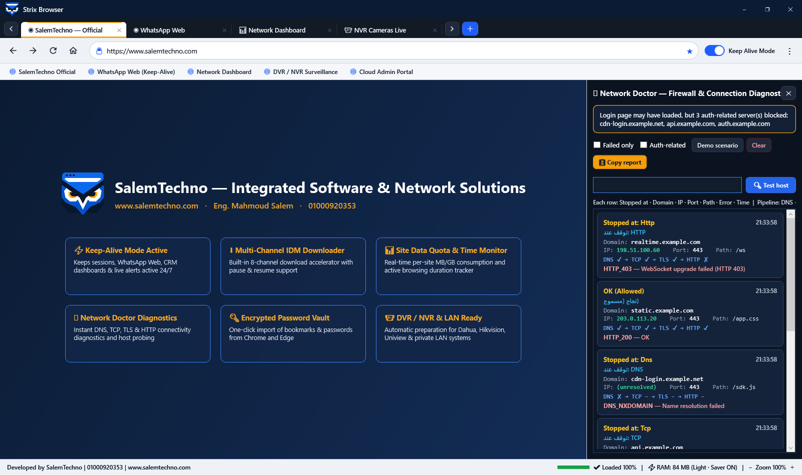
</div>

- **🇪🇬 عربي:** لوحة جانبية فورية تفتح بالاختصار `Ctrl+Shift+D` تحلل المسار الكامل لأي طلب (`DNS → TCP → TLS → HTTP`) وتكشف فوراً هل المشكلة في الـ DNS أم حجب TCP/Firewall أم شهادة TLS أم خطأ HTTP، مع فلترة الأخطاء وروابط تسجيل الدخول (`Auth only`) وزر `Copy report` الجاهز للمشاركة.
- **🇬🇧 English:** Side diagnostic console (`Ctrl+Shift+D`) dissecting every stage (`DNS → TCP → TLS → HTTP`) with resolved IPs, ports, exact failure point, live `Probe URL`, `Failed only` / `Auth only` filters, and 1-click formatted report copy.

---

### 🔹 شاشة (05): الإعدادات العامة، مركز الحسابات وGmail، والاستيراد السريع | General Settings, Accounts Hub & Import

<div align="center">
  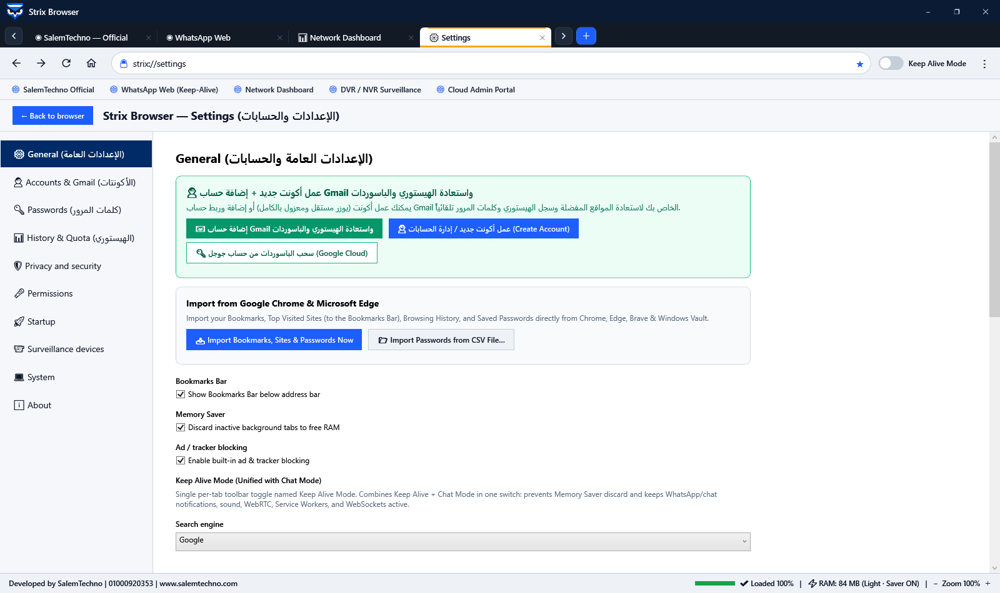
</div>

- **🇪🇬 عربي:** بطاقة خضراء بارزة في أعلى الإعدادات لإنشاء أكونت جديد، ربط حساب **Gmail** واستعادة الهيستوري والباسوردات، وسحب باسوردات **Google Cloud**، إلى جانب الاستيراد غير المعطِّل للواجهة من **Chrome / Edge / Brave / Opera / Windows Vault**، وضبط شريط المفضلة، وموفر الذاكرة، ومانع الإعلانات، ومحرك البحث.
- **🇬🇧 English:** Prominent top hub card for creating isolated accounts, linking Gmail, and pulling Google Cloud passwords, alongside non-blocking multi-browser import, Bookmarks Bar toggle, real Memory Saver, Ad/Tracker Blocker, and default Search Engine.

---

### 🔹 شاشة (06): خزنة كلمات المرور المشفرة وسحب باسوردات Google Cloud | Encrypted Password Vault & Google Cloud Pull

<div align="center">
  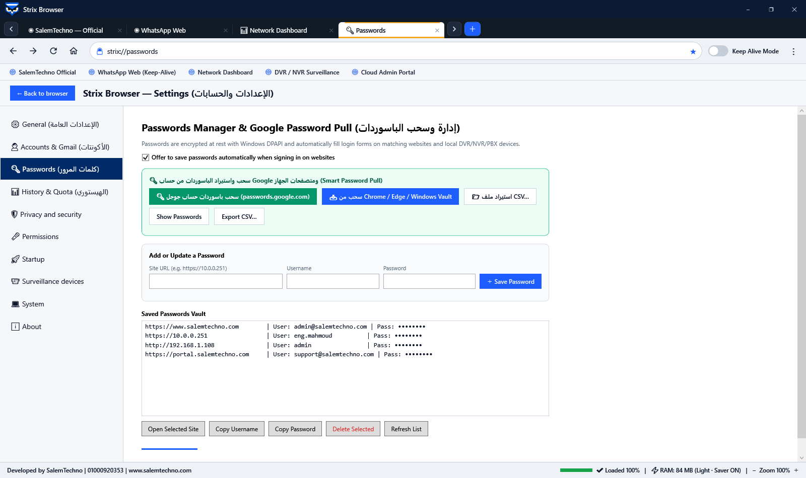
</div>

- **🇪🇬 عربي:** خزنة مشفرة محلياً عبر `Windows DPAPI` مع حماية الإظهار والتصدير بصلاحية المسؤول (`UAC`)، وزر مباشر لسحب باسوردات حساب جوجل (`passwords.google.com`) داخل المتصفح مع الالتقاط التلقائي والتشفير وحذف ملف الـ CSV المؤقت، وإضافة يدوية لأجهزة الـ DVR/NVR والمواقع.
- **🇬🇧 English:** Local `Windows DPAPI` encrypted password vault with `Admin UAC` gate for plaintext reveal/CSV export, 1-click in-browser `passwords.google.com` automatic pull & secure temp-file cleanup, and manual entry support for LAN devices.

---

### 🔹 شاشة (07): سجل التصفح التفصيلي وكوتا استهلاك المواقع | Browsing History, Per-Site Quota & Duration

<div align="center">
  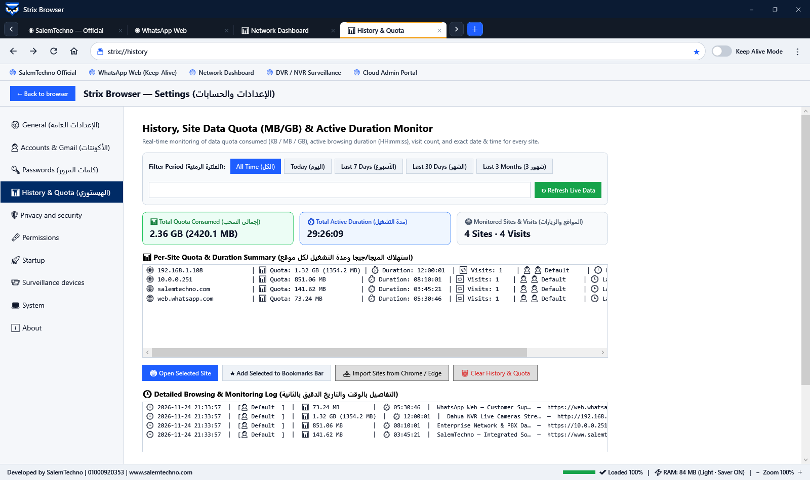
</div>

- **🇪🇬 عربي:** لوحة تحليل شاملة تعرض إجمالي الاستهلاك (`MB / GB`)، إجمالي مدة الاستخدام، ترتيب المواقع حسب الاستهلاك، وسجل الزيارات الدقيق بالتاريخ والوقت، مع فلاتر (`Today / Week / Month / 3 Months / All`) وبحث سلس، وتجميع جميع البروفايلات في وضع `Default` مع عزل تام داخل كل بروفايل مخصص.
- **🇬🇧 English:** Comprehensive per-domain bandwidth (`MB/GB`) and active duration analytics dashboard with period filters, smooth debounced search, cross-profile aggregation in `Default` mode, and strict isolation inside custom profiles.

---

### 🔹 شاشة (08): الخصوصية والأمان ومسح بيانات التصفح | Privacy, Security & Real Cache Clearing

<div align="center">
  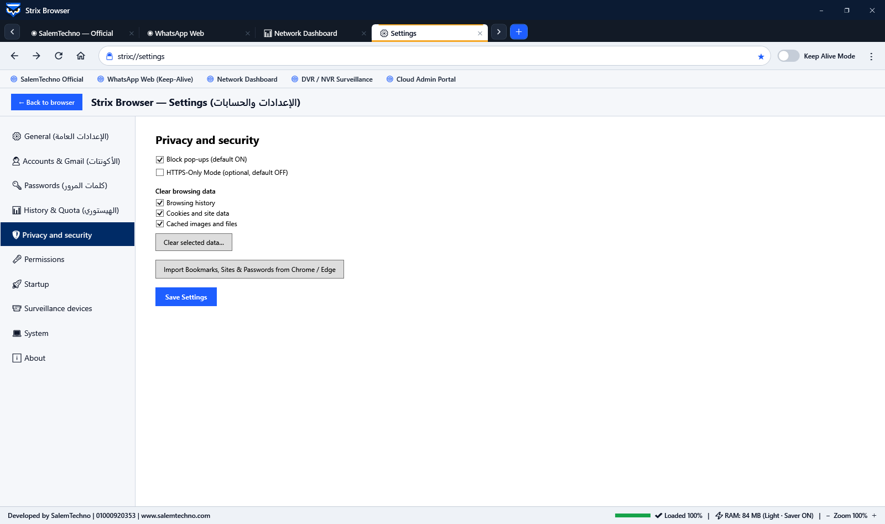
</div>

- **🇪🇬 عربي:** التحكم في مانع النوافذ المنبثقة (`Pop-up Blocker`) مع الحفاظ على نوافذ `OAuth/3DS` الشرعية، تفعيل وضع **`HTTPS-Only Mode`** الحقيقي على مستوى التصفح، ومسح حقيقي للسجل والكوكيز والكاش القرصي وكاش الأيقونات.
- **🇬🇧 English:** Configure smart Pop-up Blocker (preserving legitimate OAuth/3DS flows), real navigation-level **`HTTPS-Only Mode`**, and genuine browsing data cleanup (History, CEF Cookies, HTTP/Code/GPU disk caches, and Favicon cache).

---

### 🔹 شاشة (09): إدارة أذونات المواقع (المايك، الكاميرا، الإشعارات، الصوت) | Site & WebRTC Media Permissions

<div align="center">
  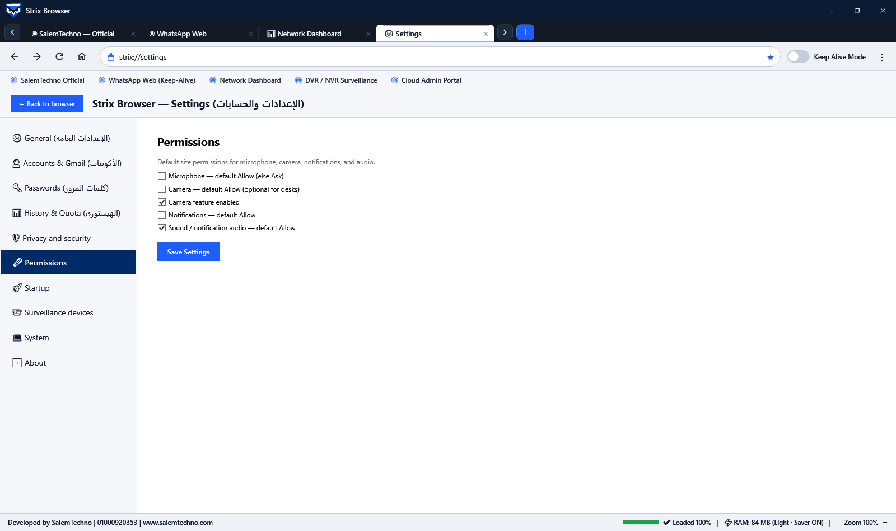
</div>

- **🇪🇬 عربي:** تحكم دقيق في أذونات **الميكروفون والكاميرا (WebRTC)، إشعارات سطح المكتب، وتشغيل الصوت** بشكل مستدام لكل بروفايل (دون حفظ أي أذونات من التابات المتخفية).
- **🇬🇧 English:** Persistent per-profile WebRTC Microphone, Camera, Desktop Notifications, and Audio playback defaults with strict Incognito non-persistence.

---

### 🔹 شاشة (10): بدء التشغيل، الصفحة الرئيسية، واستعادة الجلسات | Startup, Home Page & Session Restore

<div align="center">
  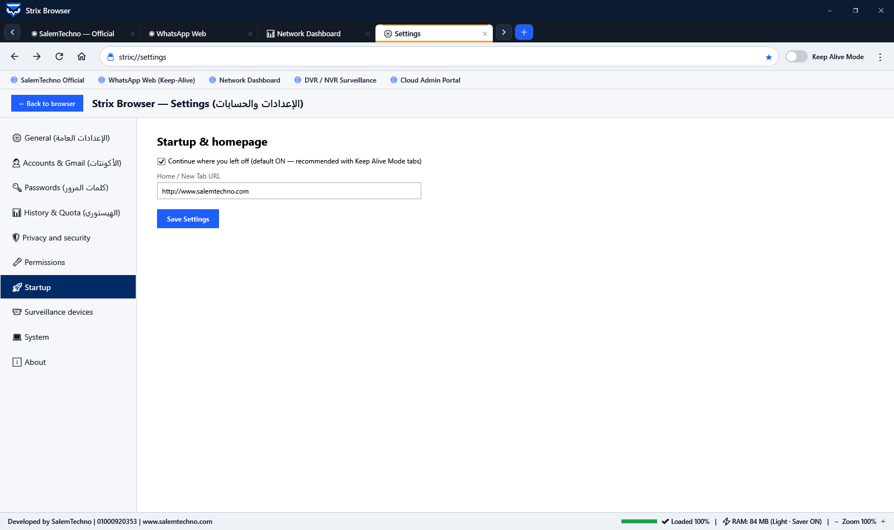
</div>

- **🇪🇬 عربي:** تخصيص الصفحة الرئيسية (`Home URL`) وخيار **`Continue where you left off`** مع حفظ دائم في `preferences.json` واستعادة ذكية للتابات بعد أي إغلاق مفاجئ عبر شريط داخلي غير معطِّل.
- **🇬🇧 English:** Persisted custom Home URL and **`Continue where you left off`** preferences backed by atomic `preferences.json` storage and non-blocking crash-recovery restore banners.

---

### 🔹 شاشة (11): إعدادات أجهزة المراقبة والكاميرات (`DVR / NVR`) | Surveillance Devices & LAN Recorder Settings

<div align="center">
  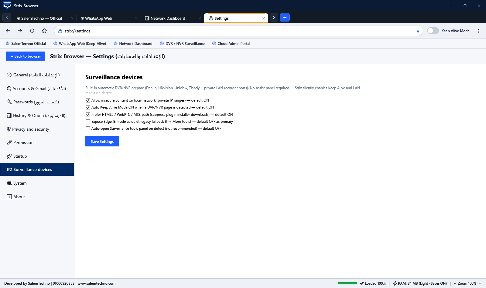
</div>

- **🇪🇬 عربي:** خيارات التهيئة التلقائية الصامتة لأنظمة المراقبة: قبول الشهادات الذاتية على الشبكة المحلية فقط (`Private LAN Only`)، التفعيل التلقائي لـ `Keep Alive Mode` عند فتح كاميرات، تفضيل مسار `HTML5 / WebRTC / H.265`، وخيار `Edge IE mode` الاحتياطي.
- **🇬🇧 English:** Fine-tune silent DVR/NVR preparation: private-LAN-only self-signed cert acceptance, automatic `Keep Alive` activation, `HTML5 / HEVC / WebRTC` priority, and quiet optional `Edge IE mode` fallback.

---

### 🔹 شاشة (12): معلومات النظام والمنصة | System & Platform Architecture

<div align="center">
  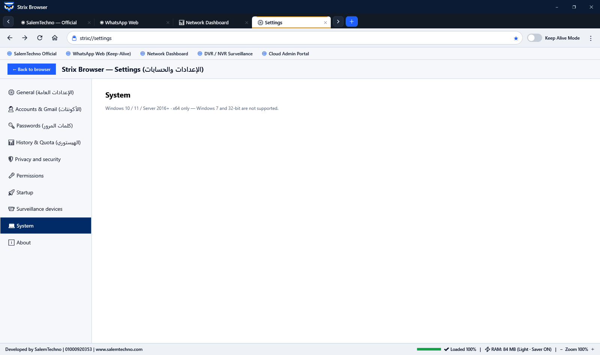
</div>

- **🇪🇬 عربي:** يعرض مواصفات بيئة التشغيل (`Windows 64-bit x64`, `Chromium 131`, `.NET 8 Self-Contained ReadyToRun`) ومسارات ملفات التشخيص والسجلات المحلية.
- **🇬🇧 English:** Displays live x64 runtime platform details (`Chromium 131`, `.NET 8.0.31 Self-Contained AOT`) and local diagnostic log paths.

---

### 🔹 شاشة (13): حول متصفح Strix Browser وبيانات الشركة المطورة | About Strix Browser & Salem Techno

<div align="center">
  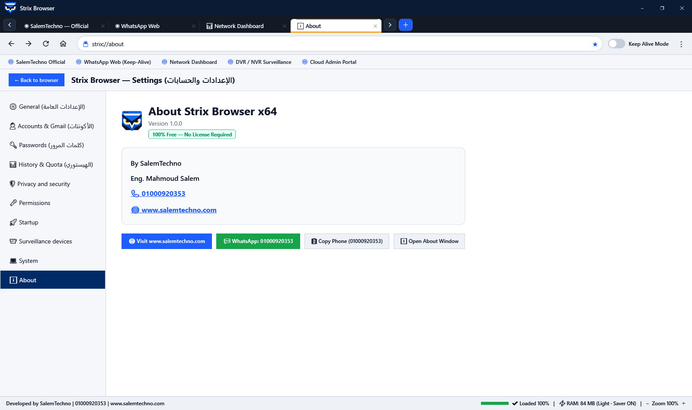
</div>

- **🇪🇬 عربي:** بطاقة الإصدار الرسمية `v1.0.0`، بيانات المهندس محمود سالم وشركة **Salem Techno**، وروابط التواصل السريع عبر الموقع الرسمي وواتساب.
- **🇬🇧 English:** Official `v1.0.0` product identity, developer attribution (**Eng. Mahmoud Salem — Salem Techno**), and 1-click website & WhatsApp contact links.

---

<a id="specs"></a>
## ⚙️ المواصفات الفنية الكاملة | Complete Technical Specifications

| المواصفة (Specification) | التفاصيل الفنية (Technical Details) |
| :--- | :--- |
| **اسم المنتج والإصدار (Product & Version)** | **Strix Browser v1.0.0** (Official Production Release) |
| **محرك التصفح (Rendering Engine)** | **Chromium 131.3.50** (CefSharp WPF HwndHost — Native C++ Fast-Path) |
| **بيئة التشغيل (Runtime & Compilation)** | **`.NET 8.0.31 Windows Desktop`** — **100% Self-Contained** + **ReadyToRun (AOT)** |
| **الأنظمة المدعومة (Supported OS)** | **Windows 10 / Windows 11 / Windows Server 2016 / 2019 / 2022 (64-bit x64)** |
| **المتطلبات الخارجية (Prerequisites)** | **لا يوجد (ZERO)** — جميع مكتبات `.NET 8` و `VC++ 140` مدمجة بالكامل |
| **تشفير الخزنة والمزامنة (Encryption)** | **Windows DPAPI (CurrentUser)** + **AES-256-GCM (`PBKDF2-SHA256`, 60,000 iterations — `STRX2`)** |
| **دعم الوسائط والمراقبة (Media & CCTV)** | **HTML5, WebRTC, MSE, Hardware H.264 / H.265 (HEVC), GPU Rasterization, Zero-Copy** |
| **سلامة البيانات والسجلات (Reliability)** | **Atomic File Writes (`.tmp -> File.Move`)** + **Rotating `CrashLogger` (7-day / 2MB cap)** |
| **دعم الشبكات (Networking)** | **QUIC / HTTP3**, System Proxy & PAC Auto-Support, Built-in `DNS -> TCP -> TLS -> HTTP` Doctor |
| **المجلدات المصممة للإصدارات (Versioning)** | هيكل مجلدات مستقل لكل إصدار (`v1.0.0/`، ثم `v1.1.0/`، إلخ) مع بصمات `SHA-256` |

---

<a id="security"></a>
## 🔐 الأمان وسلامة الملفات (`SHA-256`) | Security Architecture & Integrity Checksums

- **التحقق الصارم من شهادات HTTPS:** يتم التحقق من كافة شهادات SSL/TLS على الإنترنت العام تلقائياً، ولا تُقبل الشهادات الذاتية إلا لعناوين الشبكة المحلية (`10.x` / `192.168.x` / `172.16-31.x` / `localhost`) أو بعد موافقة صريحة من المستخدم للجلسة الحالية فقط.
- **حماية الباسوردات والملفات:** جميع ملفات البيانات (`vault.dpapi.json`, `history.json`, `preferences.json`, `profiles.json`, `bookmarks.json`, `session.json`) محمية بكتابة ذرية (`Atomic Write`) وتأمين كامل للخيوط (`Thread-Safe Locking`) لمنع التلف، ولا يُسمح بملء باسورد `HTTPS` داخل صفحة `HTTP`.
- **عزل تام للتصفح المتخفي:** كل تابة متخفية تعمل داخل `CEF RequestContext` بالذاكرة فقط (`CachePath = ""`) وموسومة برمجياً على مستوى التابة لمنع أي كتابة في الهيستوري أو الكوتا أو الأيقونات أو الأذونات.

### 🧾 بصمات التحقق الأمنية (`SHA-256 Checksums — v1.0.0`)

```text
1EA604E66AE75D58555B22F7A8B76533BE5C266627D4BD2FB2C34E3A968A8778  StrixBrowser-Setup-1.0.0-x64.exe   (135.20 MB)
B3744CCF718753E1FB2FBF93BA3137690F57F46EBE16490859A581F5D33CEF63  StrixBrowser-1.0.0.msi             (135.71 MB)
195E342484E00170FBC65625D9D2C5BCBEA2CCDFF717CADC19089338BBEF0D24  StrixBrowser-Portable-1.0.0-x64.zip (181.99 MB)
```

---

<a id="contact"></a>
## 📞 التواصل والدعم الفني والترخيص | Contact, Enterprise Support & License

<div align="center">

**تم التصميم والتطوير والهندسة بالكامل بواسطة: مهندس محمود سالم (Eng. Mahmoud Salem)**  
**شركة سالم تيكنو للحلول التقنية والشبكات — Salem Techno IT Solutions**

<p align="center">
  <a href="https://www.salemtechno.com">
    
  </a>
  <a href="https://wa.me/201000920353">
    
  </a>
</p>

📄 **الترخيص (License):** جميع الحقوق محفوظة © 2026 شركة **Salem Techno** — م. محمود سالم. راجع ملف [`LICENSE`](./LICENSE) للتفاصيل.

</div>
